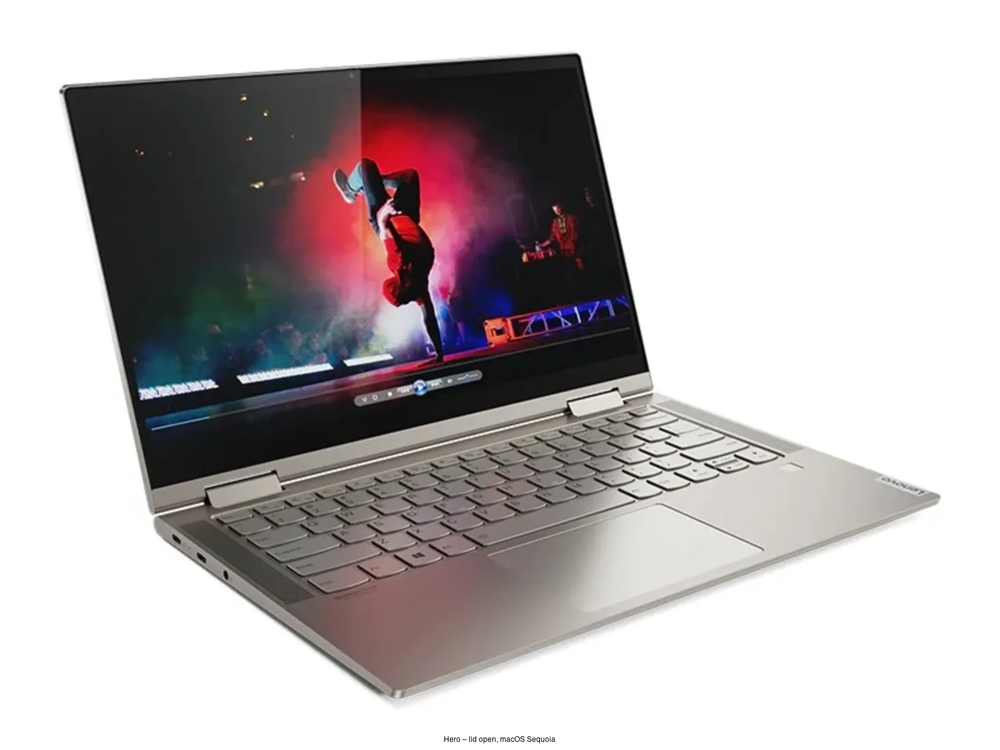
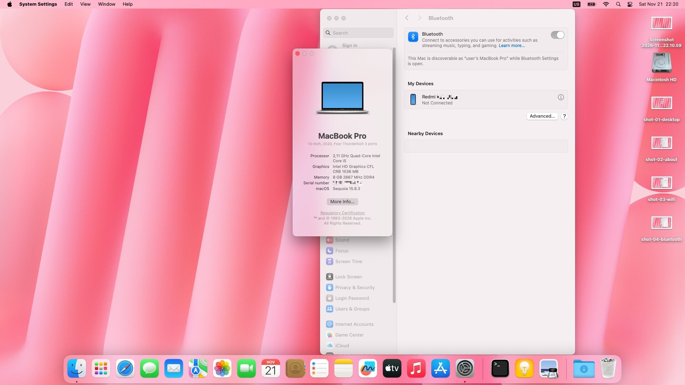
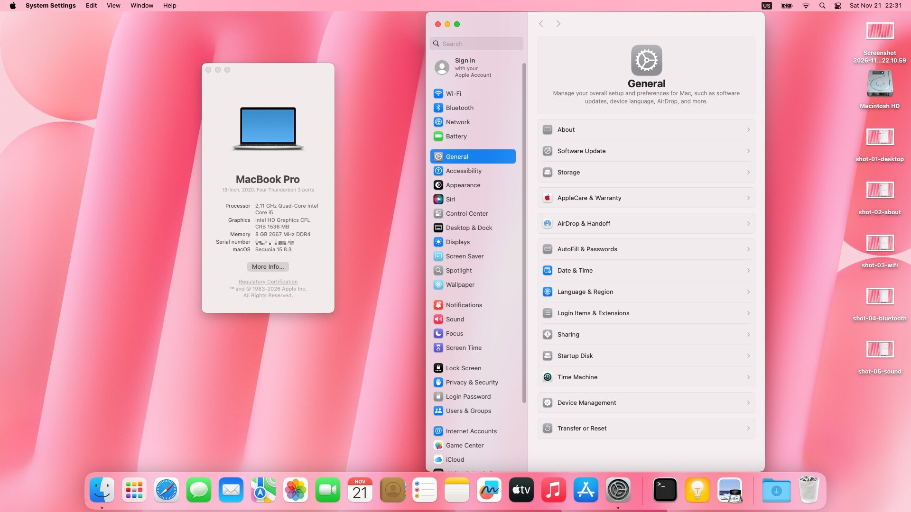
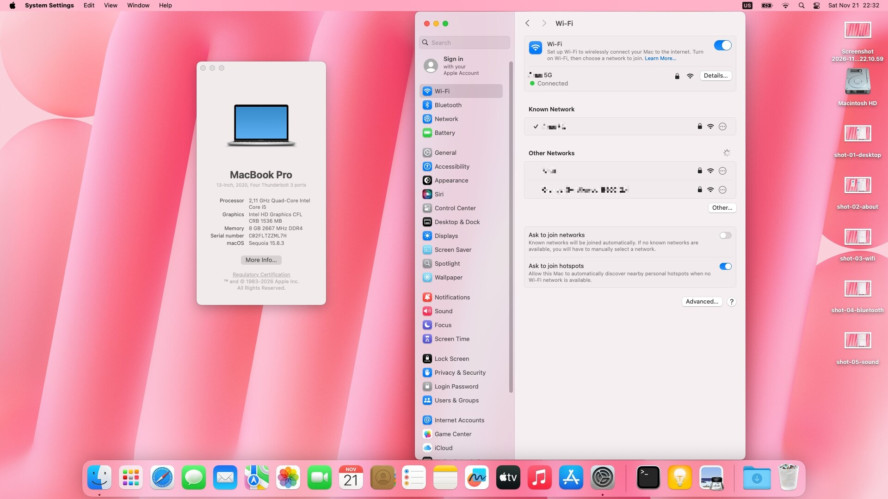
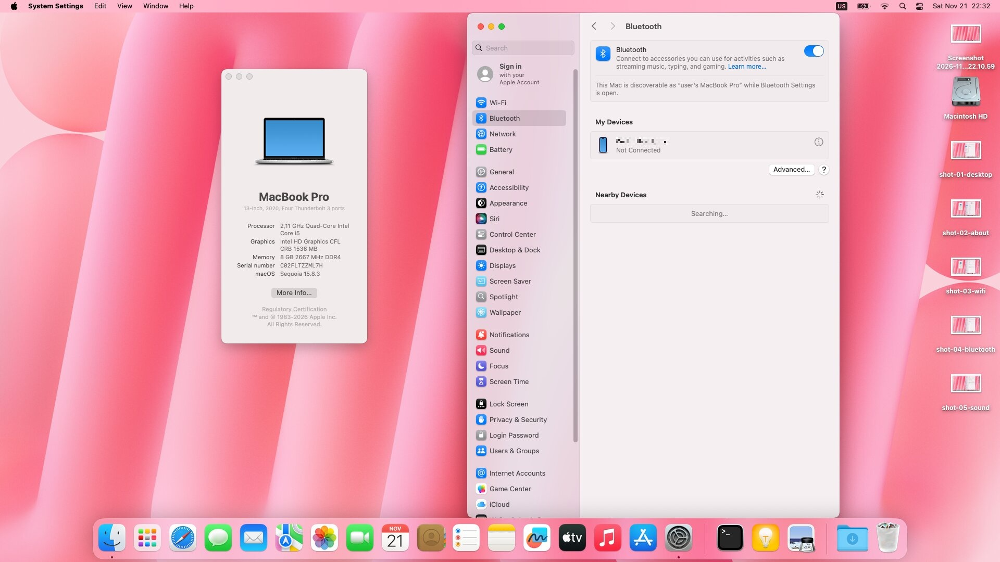
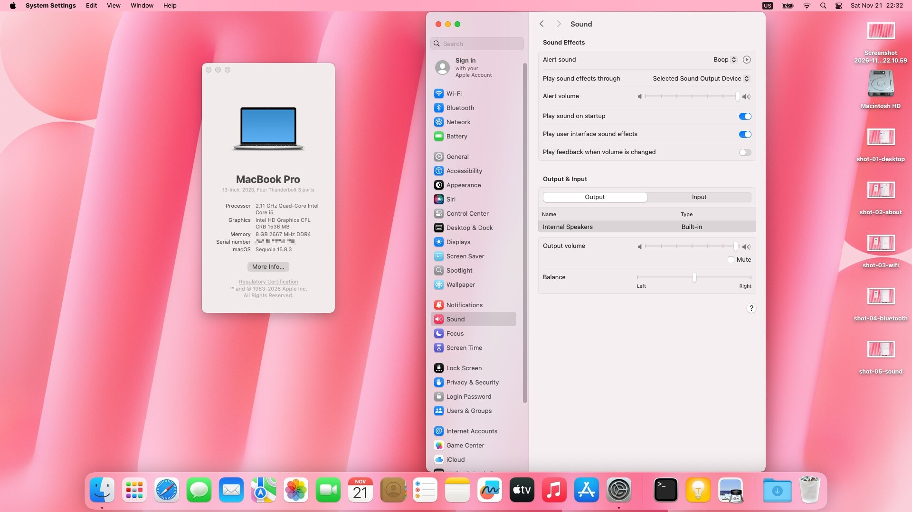

# Lenovo C740-14IML macOS Sequoia – OpenCore 1.0.8

  

### macOS Sequoia 15.8.3 running on the Lenovo Yoga C740-14IML with OpenCore 1.0.8

---

## 📋 At a Glance

### ✅ What works
- **Model** – Yoga C740‑14IML (product 81TC)  
- **CPU** – Intel Core i5‑10210U (4‑core 2.11 GHz)  
- **GPU** – Intel UHD 620 (`8086:9b41`)  
- **RAM** – 8 GB DDR4‑2667  
- **Storage** – Kingston SNV2S250G NVMe (`2646:5017`)  
- **Audio** – ALC285 behind cAVS `8086:02c8`, layout 61 (speakers + headphone jack)  
- **Wi‑Fi** – Intel AX201 (`8086:02f0`)  
- **Bluetooth** – Intel AX201 USB (`8087:0026`)  
- **Webcam** – `5986:2115` (UVC, works)  
- **Touchpad** – Synaptics `06CB:CD3E` (tap + double‑click mostly)  
- **Boot chime** – works with AudioDxe forced to cAVS (48 kHz)  
- **Sleep / wake** – 6‑second captured interval (verified)  
- **CFG‑Lock** – set (`rdmsr 0xE2 = 1e008008`)  
- **OpenCore** – 1.0.8 published, 1.0.7 as booted  

### ⚠️ Known limitations
- **Touchscreen** – VoodooI2C multitouch panics in `parseElements +0x3eb`; experiment not run (2.6.5)  
- **Force‑Touch** – pressure/median values are stale (0/40 in kext)  
- **iServices** – never configured; generate your own SMBIOS identity  
- **AirDrop / Handoff / Sidecar / iMessage / FaceTime / Apple Watch unlock** – *unverified*  
- **CPUFriend, CPU port mapping, custom OpenCanopy wallpaper** – *unverified*  

### ❓ Not attempted (yet)
- AirDrop, Handoff, Sidecar, iMessage, FaceTime, Apple Watch unlock  
- USB‑port mapping, CPUFriend, custom OpenCanopy wallpaper  
- Any further touchscreen‑panic work beyond the unrun 2.6.5 experiment  

---

## 🖼️  Screenshot / illustration gallery

  
  
  
   
  
  

*Each image is a quick visual aid; the real evidence lives in the `evidence/` folder.*

---

## ⚡️ Quick Start (for your own machine)

1. **Generate a unique SMBIOS identity** with `GenSMBIOS` (or your preferred tool).  
2. **Populate `EFI/OC/config.plist`**  
   - `SystemSerialNumber`, `MLB`, `SystemUUID` – from GenSMBIOS  
   - `ROM` – set to **your** `en0` MAC address (`ifconfig en0 | grep ether`)  
3. **Boot** with the EFI partition mounted; the first macOS start will take a little longer while the kernel builds the slide.  
4. **Read** `docs/INSTALL.md` and `docs/VERIFY.md` for validation steps.  

---

## 📁  Full evidence (collapsed)

  
▶️ Show full evidence links

  - `evidence/dmidecode.txt` – model, board, BIOS  
  - `evidence/sysprof-all.txt` – CPU, RAM, storage, GPU, audio, Wi‑Fi, Bluetooth, macOS version, boot‑args, sleep/wake  
  - `evidence/lspci-nn.txt` – PCI IDs (GPU, USB, Audio, Wi‑Fi, Bluetooth, etc.)  
  - `evidence/lsusb.txt` – USB devices (Bluetooth, Webcam, Touchpad, Fingerprint)  
  - `evidence/msr-e2.txt` – CFG‑Lock status  
  - `evidence/config-redacted.json` & `evidence/config-keys.txt` – OpenCore quirks & boot‑args  
  - `evidence/sleep-wake.log` – sleep/wake intervals  
  - `evidence/macos-panic.txt` – touchscreen‑panic stack (if needed)  
  - `evidence/windows.txt` – no Windows install shares the disk  
  - `bundle/logs/TOUCHPAD.md`, `bundle/logs/TOUCHPAD_SETTLED.md` – touchpad behaviour logs  
  - `bundle/logs/THIRD_PARTY_REFINED.md` – third‑party touchscreen findings  
  - `MANIFEST.md`, `ERRATA.md` – build‑level metadata  

